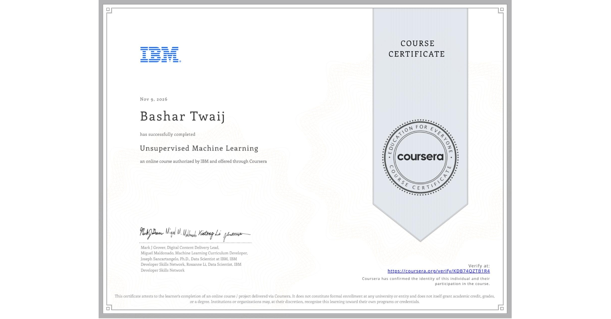

# 🔬 Unsupervised Machine Learning — Final Project & Interactive Observatory

### **Chemometric Manifold Discovery, Clustering Benchmark & Supervised Revisit**

[-06B6D4?style=for-the-badge&logo=github&logoColor=white)](https://1stanunnaki.github.io/unsupervised-ml-final-project/)

[-6366F1?style=for-the-badge)](./Unsupervised_ML_Final_Project_Report.pdf)
[-10B981?style=for-the-badge)](./Unsupervised_ML_Complete_Exam_and_Project_Guide.pdf)

> **👉 [اضغط هنا لفتح موقع المحاكاة التفاعلي للمشروع على GitHub Pages (يدعم الإنجليزية والعربية)](https://1stanunnaki.github.io/unsupervised-ml-final-project/) 👈**

---

**Author:** **Bashar Twaij** (`1stANUNNAKI` — انـونـاكـي)  
**Course:** IBM Machine Learning Professional Certificate — *Unsupervised Machine Learning*  
**Dataset:** UCI Wine Chemical Dataset ($N = 178$ batches, $13$ raw + $3$ engineered ratios = $16$ standardized dimensions)

---

## 🌐 Live Interactive Web Application (GitHub Pages)

The interactive web observatory simulates the entire Unsupervised Machine Learning workflow in real time with **English as the default language** and an instant **Arabic (RTL)** toggle:

- **🔗 Live Interactive Observatory:** [https://1stanunnaki.github.io/unsupervised-ml-final-project/](https://1stanunnaki.github.io/unsupervised-ml-final-project/)
  - **Interactive 3D PCA Manifold Canvas:** Drag-to-rotate 3D projection of all 178 chemical batches across `PC1 × PC2 × PC3` (`68.90%` variance).
  - **2D Embedding & Clustering Workbench:** Switch dynamically between `PCA`, `t-SNE`, and `Metric MDS` projections, color-coded by `K-Means`, `Agglomerative (Complete/Ward)`, `DBSCAN`, `GMM`, or `True Cultivars`, with live sample hover chemistry inspection.
  - **Interactive Ward Dendrogram Slicer:** Drag the horizontal cut-height slider to slice the hierarchical merge tree and inspect resulting clusters in real time.
  - **Stakeholder Report & Exam Verification Suite:** Interactive walkthrough of all 6 rubric sections and all 5 final exam questions.

---

## 📊 Executive Summary & Key Empirical Findings

| Dimension / Model | Key Configuration | Internal Metric (Silhouette / Var) | External Validation (ARI / NMI) | Key Insight |
| :--- | :--- | :--- | :--- | :--- |
| **PCA** | `n_components=16` | `PC1=37.02%`, `PC2=20.76%` (`57.79%` 2D; `79.48%` 5D) | — | Compresses 16 features into 5 orthogonal factors with 79.48% information retention. |
| **t-SNE** | `perplexity=30` | `KL Divergence = 0.1460` | — | Preserves local neighborhood topology with 3 well-isolated visual islands. |
| **K-Means (16D)** | `k=3, n_init=20` | `Silhouette = 0.2986`, `WCSS = 1491.27`, `CH = 79.61` | `ARI = 0.9122`, `NMI = 0.8844` | Strong baseline; fast, deterministic, interpretable centroids. |
| **K-Means (PCA-5D)** | `k=3 on Top 5 PCs` | `Silhouette = 0.3945` (**+32.1%**) | `ARI = 0.9114`, `NMI = 0.8805` | Truncating trailing noise PCs boosts cluster compactness by +32.1%. |
| **Agglomerative** | `k=3, Complete / Ward` | `Sil = 0.2961` (Complete), `0.2907` (Ward) | `ARI = 0.9471` (Complete), `0.8989` (Ward) | Complete/Ward excel; Single/Average fail (`ARI = -0.0038`) due to chaining. |
| **DBSCAN (16D vs 2D)** | `eps=0.65, min_samples=6` (PCA-2D) | `Core Sil = 0.4502` (`8.43%` noise in 2D vs `47.19%` in 16D) | `ARI = 0.7289`, `NMI = 0.7294` | Demonstrates curse of dimensionality in 16D and isolates 15 boundary anomalies in 2D. |
| **GMM (EM)** | `k=3, covariance='full'` | `Sil = 0.2988`, `BIC = 5070.88`, `AIC = 3613.63` | `ARI = 0.9637`, `NMI = 0.9537` | Highest external fidelity via full-covariance ellipses and soft probabilities. |
| **Supervised Revisit** | `5-Fold CV Ridge (color_intensity)` | `Global R² = 0.6201` → `Cluster-Local R² = 0.6868` | `Augmented R² = 0.6955`, `RMSE = 1.2440` | Unsupervised regime discovery reduces prediction error by **9.21%**. |

---

## ✅ Final Exam Verified Answers (15 / 15 Points)

1. **Question 1 (8 Points — Upload Final Report PDF):** Upload [`Unsupervised_ML_Final_Project_Report.pdf`](./Unsupervised_ML_Final_Project_Report.pdf) (contains all 6 required sections: PDF format, Data Description, Objective, Model Comparisons, Key Findings, Limitations & Next Steps).
2. **Question 2 (2 Points — Multiple Select):**
   - `[✓]` Components are ranked from highest variance to lowest variance
   - `[ ]` *(Do NOT select)* PCA works best when features are independent and not correlated
   - `[✓]` A principal component is a weighted combination of original features
   - `[✓]` PCA loadings can help understand which original variables influence a component
3. **Question 3 (1 Point — Multiple Choice):**
   - `(●)` To visualize how clusters merge and help decide cluster count
4. **Question 4 (1 Point — Multiple Choice):**
   - `(●)` Try different preprocessing, features, or clustering models
5. **Question 5 (3 Points — Multiple Select):**
   - `[✓]` Using appropriate evaluation metrics (e.g., silhouette score, inertia)
   - `[✓]` Testing different hyperparameters (e.g., number of clusters, linkage method)
   - `[ ]` *(Do NOT select)* Selecting the model that produces the most clusters
   - `[✓]` Comparing different algorithms (e.g., K-Means, DBSCAN, Agglomerative)

---

## 📁 Repository Structure

- `index.html`, `styles.css`, `app.js`, `data.js` — Interactive Bilingual Web Application (3D WebGL/Canvas PCA Manifold, 2D Embedding Explorer, Interactive Ward Dendrogram Slicer, 6-Step Report Explorer, and Exam Verification Suite).
- `Unsupervised_ML_Final_Project_Report.pdf` — 7-Page Vector PDF Report ready for Question 1 submission.
- `Unsupervised_ML_Complete_Exam_and_Project_Guide.pdf` — 3-Page Complete Exam & Project Reference Guide PDF.
- `Unsupervised_ML_Final_Project.ipynb` — Complete Jupyter Notebook containing all Python code and markdown analysis.
- `run_unsupervised_pipeline.py` — Standalone reproducible Python pipeline script.
- `certificate.png` — Official IBM & Coursera Course Completion Certificate.

---

## 🏆 Official Course Certificate — شهادة إتمام الدورة المعتمدة

**Recipient:** Bashar Twaij (`1stANUNNAKI`)  
**Course:** *Unsupervised Machine Learning* — Authorized by **IBM** and offered through **Coursera**  
**Credential ID:** `KDB74QZTB1R4` · **Share Link:** [coursera.org/share/4d5409d8cde33e4bb25b65bfb0ceb432](https://coursera.org/share/4d5409d8cde33e4bb25b65bfb0ceb432) · **Verify:** [coursera.org/verify/KDB74QZTB1R4](https://coursera.org/verify/KDB74QZTB1R4)

