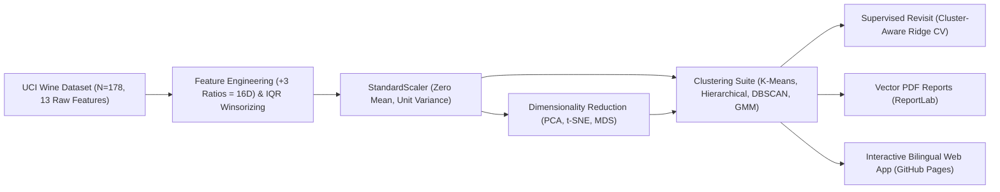

# 📐 معمارية المشروع ومنهجية التحليل (ARCHITECTURE_AND_METHODOLOGY.md)

## 1. نظرة عامة على النظام
يتكون المشروع من ثلاثة محاور متكاملة:
1. **خط أنابيب التحليل الإحصائي وتعلم الآلة (`run_unsupervised_pipeline.py` & `Unsupervised_ML_Final_Project.ipynb`):**
   - معالجة بيانات **UCI Wine Chemical Dataset** ($N = 178$ عينة، $13$ ميزة كيميائية خام).
   - هندسة $3$ نسب كيميائية حيوية (`flav_to_phenols`, `proline_to_magnesium`, `color_to_alcohol`) ليصبح المجموع $16$ ميزة.
   - تقليم القيم المتطرفة (IQR Winsorization عند $1.5 \times \text{IQR}$) وتوحيد القياس المعياري (`StandardScaler`).
   - تنفيذ خوارزميات اختزال الأبعاد (`PCA`, `t-SNE`, `MDS`) وأربع عائلات من خوارزميات التجميع (`K-Means`, `Agglomerative Hierarchical`, `DBSCAN`, `Gaussian Mixture Models`).
   - تنفيذ تجربة إعادة الزيارة الإشرافية (`Supervised Revisit`) عبر انحدار Ridge متقاطع من 5 طيات للتنبؤ بشدة اللون (`color_intensity`).
2. **محرك النشر المتجهي لملفات PDF (`Unsupervised_ML_Final_Project_Report.pdf` & `Unsupervised_ML_Complete_Exam_and_Project_Guide.pdf`):**
   - مبني باستخدام `ReportLab` برسوم متجهية خالصة (Pure Vector Graphics) لضمان قابلية استخراج النصوص بنسبة 100% بواسطة أداة التقييم الذكي **Mark** في Coursera.
3. **المرصد التفاعلي ثنائي اللغة على GitHub Pages (`index.html`, `styles.css`, `app.js`, `data.js`):**
   - تطبيق ويب تفاعلي يعمل باللغة الإنجليزية افتراضياً مع دعم كامل للترجمة الفورية إلى اللغة العربية (RTL).

